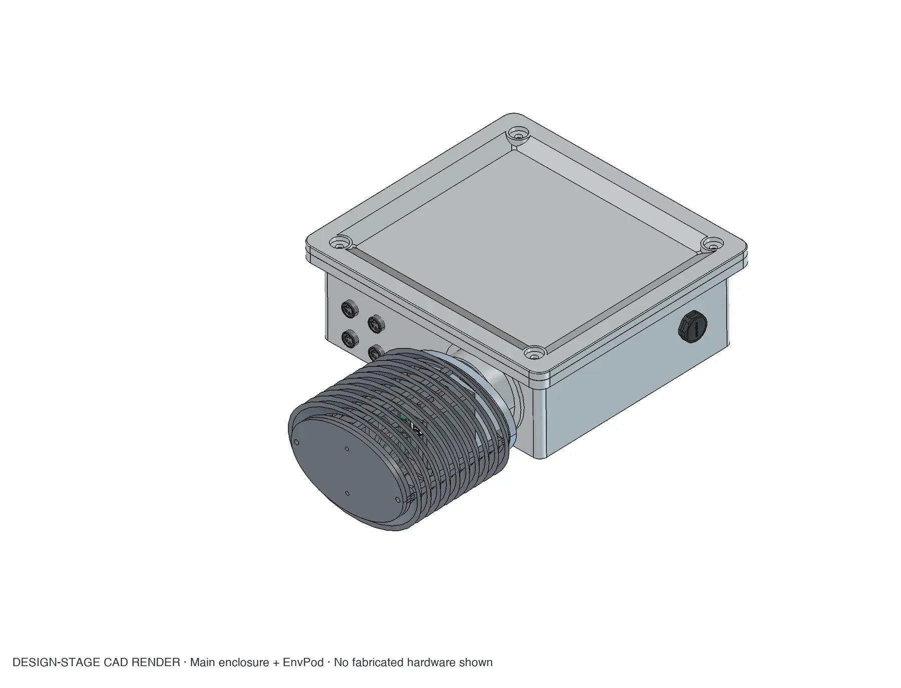
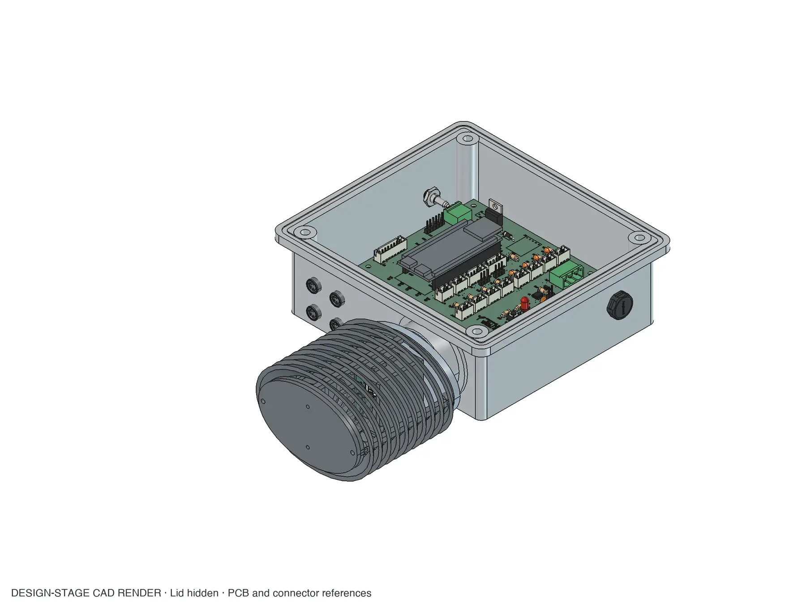
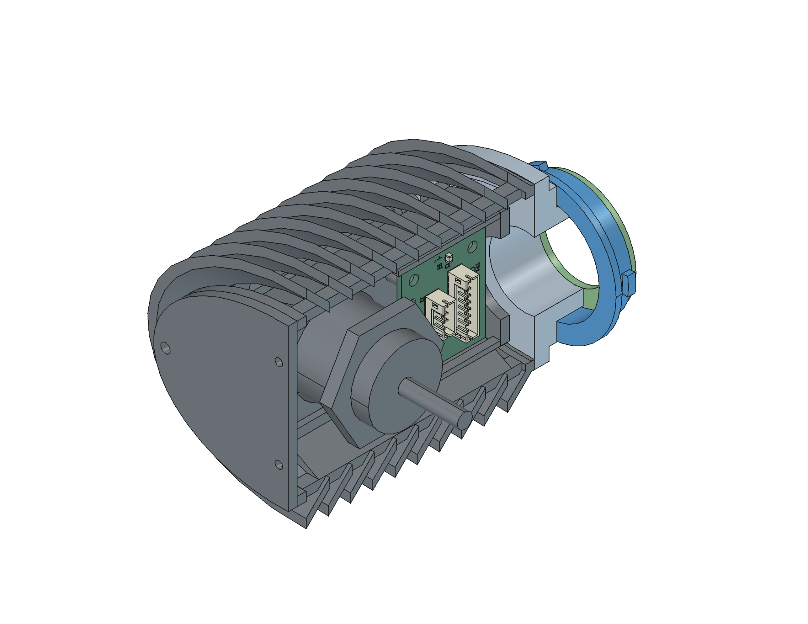
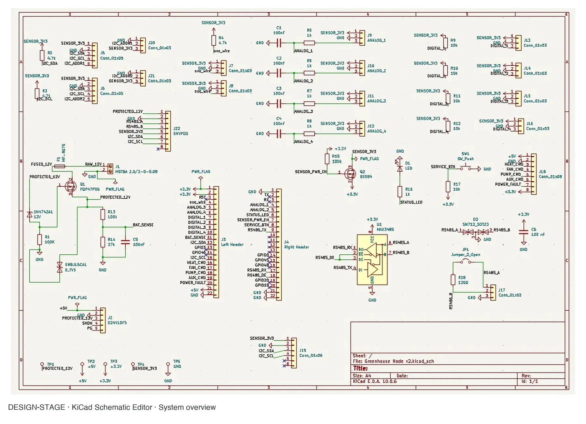
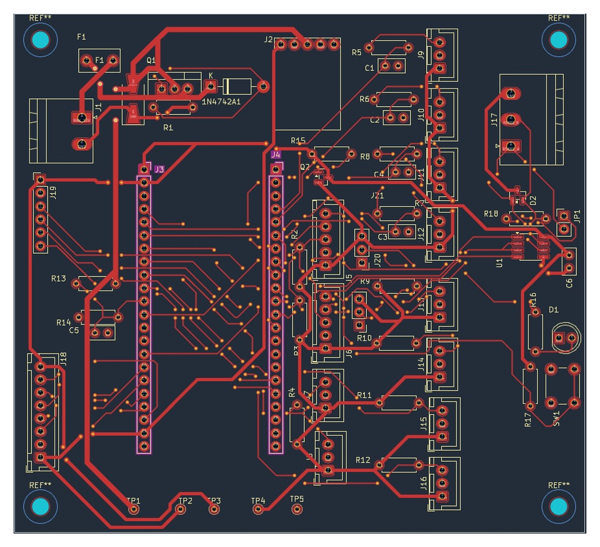
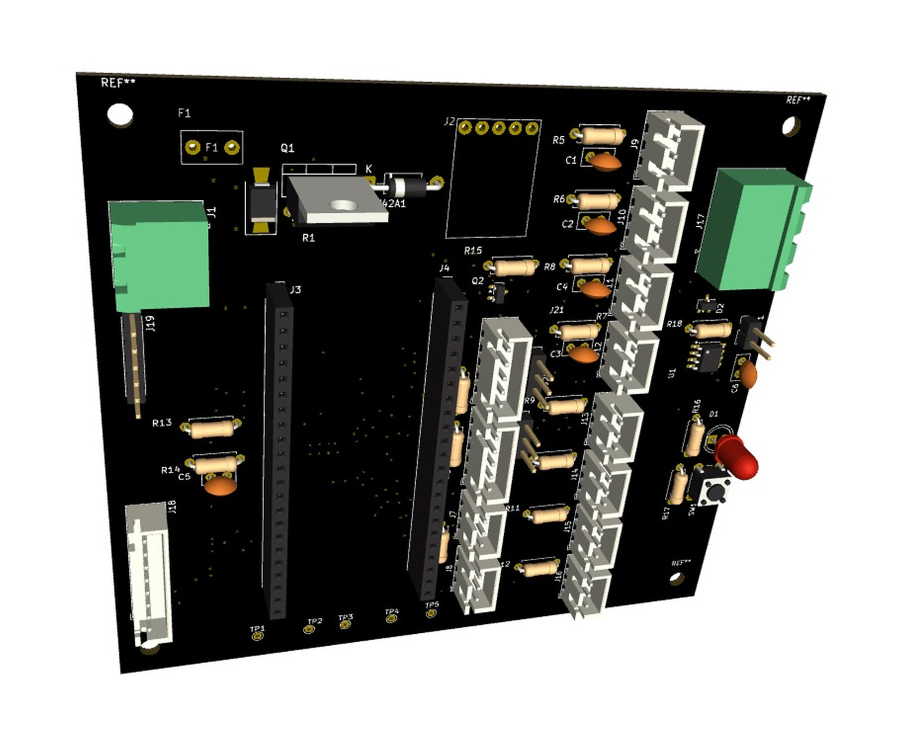

# Modular Greenhouse Control Node

## TL;DR

An active full-stack mechatronics project for monitoring greenhouse conditions and controlling ventilation through servo-actuated louvers and irrigation through electric valves. The system combines an ESP32-S3, a custom KiCad PCB, a parametric FreeCAD enclosure, sealed field connections, a removable rain-resistant sensor pod, communications, power distribution, and a planned validation program. It is designed for eventual off-grid solar operation, with generation, battery storage, and power-budget integration still pending.

**Current state:** The enclosure, louvers, servo mounting, power architecture, and PCB are in active redesign. The PCB is not fully re-routed, and fabrication, firmware bring-up, environmental testing, and final solar-power integration are pending.

*Design-stage assembly showing the main enclosure, field connections, antenna interface, and removable sensor pod. This is CAD evidence, not a fabricated unit.*

## Why it exists

A useful greenhouse node needs to do more than place sensors in a box. Sensors require exposure to ambient air and light, while the electronics need protection from rain, condensation, cable strain, and service damage. The device also needs to be expandable, repairable, and practical to fabricate.

The initial V1 concept was a sensor board in an outdoor enclosure, but it remained a design iteration and was not physically fabricated. Enclosure work exposed conflicts between sensor exposure and weather protection, leading to a removable environmental pod. Expanding the goal from monitoring conditions to controlling them introduced new requirements for power, field wiring, outputs, and service access. Those lessons are being incorporated before committing the current integrated design to fabrication.

## System overview

| Layer | Current design |
| --- | --- |
| Compute | ESP32-S3 development platform |
| Sensing | SEN0644-class environmental sensing and SHT41 temperature/humidity sensing |
| PCB | Custom carrier for power distribution, sensors, field connectors, and servo/control capability |
| Main enclosure | Parametric enclosure with sealed bulkhead connections, antenna penetration, pressure venting, and PCB mounting |
| Sensor pod | Removable louvered pod designed to admit air and light while limiting direct rain entry |
| Software | Planned embedded acquisition, communications, monitoring, and greenhouse-control layers |

## Build planning

The project includes a maintained parts list with selected components, required quantities, unit costs, and estimated build cost. Component selection is being developed alongside the mechanical and electrical design so connector availability, environmental ratings, dimensions, lead times, and price can influence the design before fabrication.

The full working repository and sourcing notes remain private. A portfolio-safe BOM summary can be published after design review.

## Mechanical design

The main enclosure and sensor pod are modeled parametrically in FreeCAD. Current features include:

- Four sealed four-pin M8 field connectors
- Weather-resistant SMA bulkhead antenna connection
- Pressure-equalization vent
- PCB standoffs for heat-set inserts
- Removable environmental sensor pod
- Rain-resistant sensor-pod louvers and rain guard
- Servo-actuated greenhouse louvers and mounting geometry in active design
- Serviceable board and cable arrangement
- Rotating locking-collar concept so the pod can remain correctly oriented

*Open design-stage enclosure view used to evaluate board mounting, connector clearance, service access, and cable arrangement.*

*Design-stage cutaway of the EnvPod, showing the louvered weather shield, compact sensor PCB, optical sensor placement, and sliding interface with the greenhouse node. Mechanical fit and retention details remain under development.*

The pod geometry, louver depth, board width, mounting features, and rain protection have been revised around component dimensions and the needs of the sensors.

## PCB and electrical design

The KiCad design is being developed around the ESP32-S3, environmental sensors, and enclosure interfaces. Work includes:

- Connector and power-distribution planning
- Sensor-interface wiring
- GPIO allocation and revision
- Footprint and header-spacing verification
- Silkscreen updates following pin-map changes
- Design-rule checks
- Power and control planning for servo-actuated louvers

*Current schematic overview. Electrical review and PCB routing are still in progress; this is not a released design.*

*Native KiCad view of the V1 board layout used as a design reference. Routing, footprint references, interfaces, and silkscreen remain subject to review as the integrated node is revised.*

*Native KiCad 3D rendering used to evaluate connector access, component placement, and the board’s relationship to the enclosure. Visible placeholder references reinforce that this is design-stage evidence rather than a released assembly.*

Physical measurements and manufacturer documentation are used when library models or early assumptions disagree with the actual hardware. ESP32 header spacing, for example, was checked against the board before routing.

## Design evolution

1. Start with an environmental sensor board.
2. Add an outdoor enclosure.
3. Separate the sensors into a ventilated, rain-resistant pod.
4. Revise PCB placement, connectors, and mounting around the full assembly.
5. Expand the architecture from monitoring into servo-actuated environmental control.
6. Finish the integrated design before printing an enclosure already known to be incomplete.

## Validation plan

Design-stage checks include component measurements, PCB design-rule checks, connector and pin-map review, and enclosure interference review.

Planned physical testing includes:

- PCB power and communications bring-up
- Sensor comparison and calibration checks
- Enclosure fit and serviceability
- Airflow response
- Splash and rain exposure
- Condensation behavior
- Thermal behavior with control loads
- Long-duration outdoor operation

## Source availability

The working repository is private while electrical interfaces, mechanical geometry, and firmware boundaries are still changing. After a routing-complete and fabricated revision passes bring-up, I plan to publish sanitized KiCad and FreeCAD sources, manufacturing outputs, firmware, the BOM, and validation evidence. A bounded private walkthrough or sanitized snapshot is available for engineering review before that milestone.

## Remaining work

- Reconcile the enclosure's PCB reference with the current editable PCB revision
- Finalize PCB routing and connector map
- Specify outdoor field cabling for the M8 runs, including conductor count and gauge, RS-485 twisted pair, shielding and grounding, voltage drop, wet-location/UV rating, conduit, and strain relief
- Complete the pod dock, lid, locking features, actuator louvers, and servo mount
- Fabricate the PCB and enclosure
- Implement and bring up firmware
- Add greenhouse monitoring and servo-control software
- Finalize solar generation, storage, and power-budget integration after actuator requirements are established
- Run environmental and long-duration validation
- Publish selected source, BOM, and test artifacts after review

