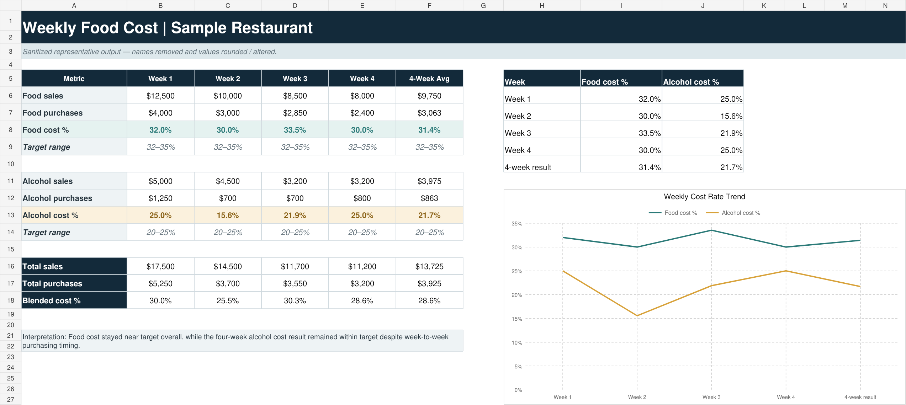
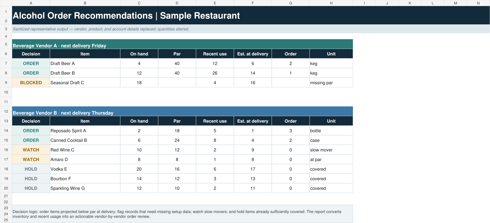
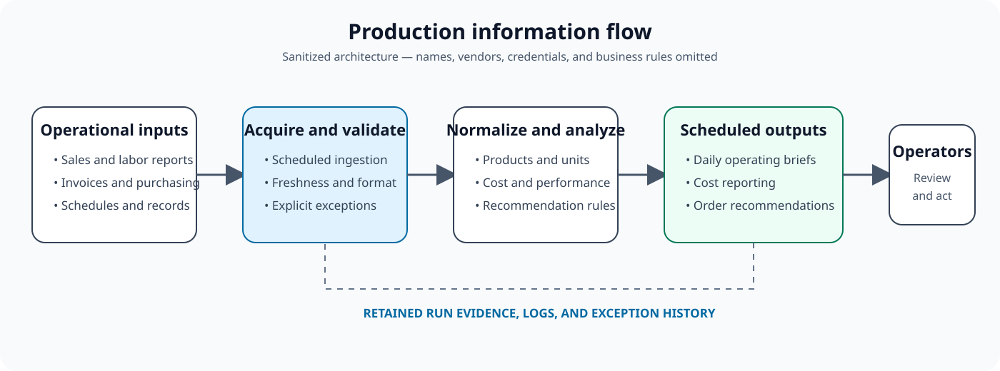
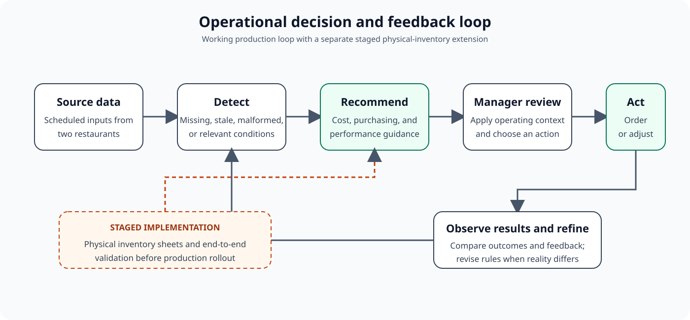

# Restaurant Operations Intelligence Platform

## TL;DR

A production operations platform that converts fragmented restaurant data into scheduled reports, cost analysis, purchasing recommendations, and exception visibility for two independent restaurants. It is designed around actual operating decisions rather than a generic dashboard and remains under active expansion as new workflows prove useful.

Production source code, operating data, credentials, commercial rules, and restaurant-specific configuration remain private.

**Current state:** Working components run in production for two independent restaurants. Additional workflows, including physical inventory capture and end-to-end inventory validation, remain in staged implementation.

## Why it exists

Restaurant decisions often depend on information spread across point-of-sale reports, invoices, schedules, purchasing records, and manual processes. Even when the underlying data exists, it may arrive too late, use inconsistent names or units, or require too much manual work to support a daily decision.

The platform collects those inputs, applies restaurant-specific business rules and validation, and delivers the resulting information when operators can use it.

## Current outputs

The deployed system produces:

- Daily operations-intelligence emails
- Morning performance indicators
- Weekly food-cost reporting
- Alcohol ordering recommendations
- Founder-level operating briefs
- Restaurant-specific schedules and configuration
- Validation and exception handling for incomplete inputs

## Representative outputs

*Representative weekly cost output. Restaurant, vendor, product, and account details were removed; figures were rounded and altered while preserving the reporting structure and calculation relationships.*

*Representative vendor-by-vendor order review. Generic products and altered quantities demonstrate the recommendation, blocked-input, watch, and hold decision paths without exposing operating data.*

## Processing flow

*Sanitized production architecture. Generic labels intentionally replace restaurant names, vendors, infrastructure details, credentials, and proprietary rules.*

1. Acquire structured and semi-structured operational inputs.
2. Normalize products, units, dates, and restaurant configuration.
3. Validate required inputs and identify stale or malformed data.
4. Apply cost, inventory, purchasing, and performance rules.
5. Render human-readable reports and machine-readable artifacts.
6. Deliver outputs through scheduled Linux services.
7. Retain logs and run evidence for investigation.

Implementation details are intentionally generalized to protect production operations and commercial intellectual property.

## Operating feedback loop

*Production outputs support manager decisions and improve through operating feedback. The physical-inventory extension is marked separately because it is still being implemented and validated.*

## Design decisions

### Shared product, restaurant-specific configuration

The two restaurants have different operating patterns, schedules, products, and reporting needs. Their differences are represented through configuration while the processing and deployment model remains shared.

### Units and pack factors are first-class data

Cases, bottles, individual items, and vendor packs cannot be treated as interchangeable quantities. Unit and pack-factor handling is maintained through ingestion, calculations, recommendation logic, and presentation.

### Missing data must remain visible

A report should not imply certainty when an upstream input is missing or stale. Validation, logging, and explicit exception paths prevent incomplete runs from silently appearing authoritative.

### Scheduled recommendations instead of another dashboard

Many restaurant decisions occur at predictable times. Scheduled briefs and recommendations reduce the work between receiving data and taking action.

### Operational feedback closes the loop

Outputs are reviewed against purchasing behavior, inventory conditions, sales patterns, and manager feedback. Rules are revised when the calculated answer does not reflect the operating reality.

## Deployment

The platform runs as scheduled services on Linux infrastructure. Each restaurant has independent configuration and delivery timing while using the same underlying application.

Deployment work includes:

- Scheduled acquisition and processing
- Client-specific runtime configuration
- Logging and retained run artifacts
- Email and attachment delivery
- Failure investigation
- Controlled rollout of new calculations and report sections

## Source availability

The production repository cannot be published as-is because it contains restaurant operating data, credentials, environment-specific configuration, commercial rules, and licensed third-party material. I plan to publish reusable components and sanitized examples as their boundaries stabilize. For an engineering review, I can provide a bounded walkthrough or a sanitized snapshot that demonstrates architecture, validation, deployment, and representative implementation without exposing restaurant data.

## Current development

Active work includes:

- Expanding the set of supported operating decisions
- Strengthening validation and deployment controls
- Improving ordering recommendations
- Automating payroll and timecard exception checks
- Improving run history and operational observability
