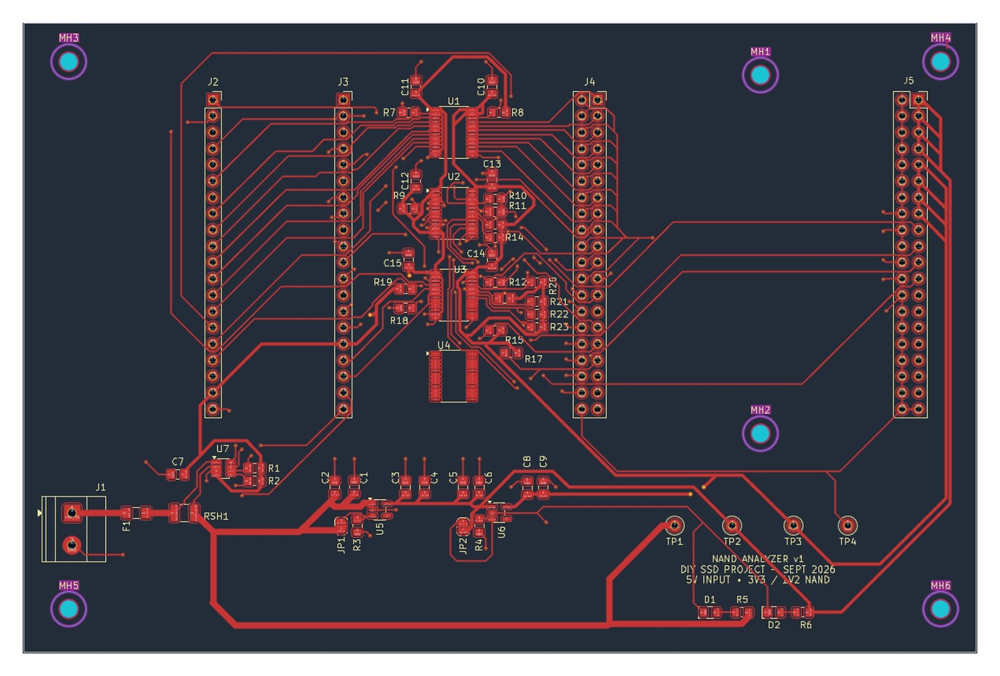
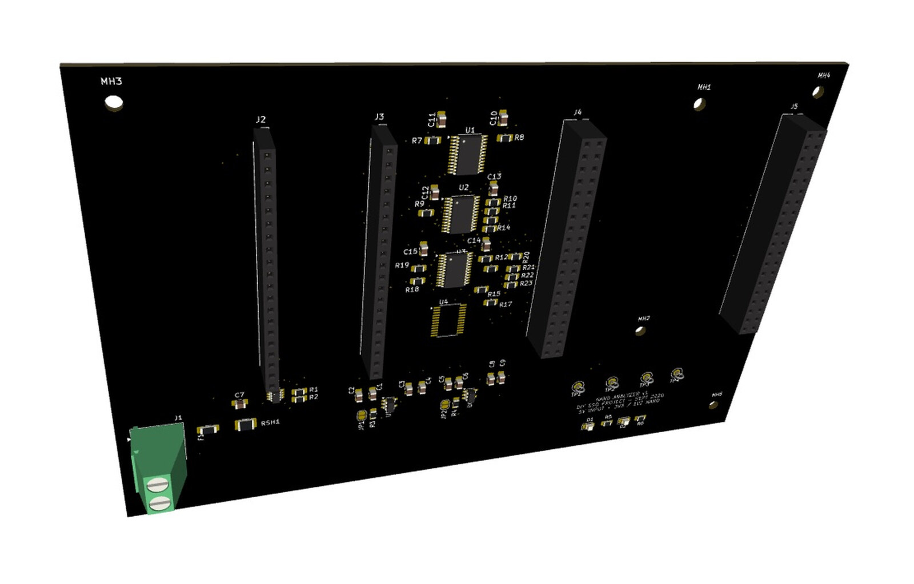

# NAND Analyzer Carrier and SSD Development Workflow

## TL;DR

A fabricated V1 NAND analyzer carrier and traceable validation workflow supporting a broader effort to build solid-state drives from raw or reclaimed NAND packages and controller boards. The project treats component identity, electrical bring-up, manufacturing-tool configuration, and finished-drive validation as one connected system rather than isolated experiments.

**Current state:** The V1 carrier PCB has been fabricated. A printed stand served as a fit check and exposed a mounting-hole spacing error; it will be revised. Assembly, electrical bring-up, NAND characterization, and repeatability testing are pending.

*Native KiCad PCB view matched to the September 2026 fabrication package. It shows the carrier routing, adapter headers, power circuitry, mounting pattern, and labeled test points without the stale unrouted-status capture.*

*KiCad 3D rendering of the fabricated V1 design and planned component population. This is a native design rendering, not a photograph of an assembled board.*

## Why it exists

This analyzer is part of a larger effort to build and validate solid-state drives rather than only evaluate loose components. Building or repairing an SSD requires a compatible combination of controller, NAND generation, geometry, firmware configuration, manufacturing tool, and board layout. Loose and harvested NAND adds more uncertainty:

- Package markings may not expose the complete internal geometry.
- Electrically functional NAND may still be unsupported by a target controller.
- Controller manufacturing tools depend on specific versions and flash databases.
- Initialization failures can originate in hardware, soldering, power, configuration, or compatibility.
- Results need to remain tied to the physical package and controller board that produced them.

The project is intended to reduce those unknowns before permanently assembling parts into an SSD.

## Current carrier design

The present source is a carrier PCB with two labeled adapter-header positions, JAD1 and JAD2, configurable jumpers, test and interface connections, and a dedicated mounting-hole pattern. Socket and adapter hardware connect through those interfaces rather than appearing as an on-board BGA clamshell socket in this revision.

That separation is deliberate: interchangeable socket adapters allow the base carrier to be reused for different NAND package types. Supporting another package should require changing the adapter rather than redesigning and manufacturing an entirely new analyzer board.

The current images are included as design evidence for the fabricated V1 carrier. Power-entry details, external adapter selection, and the full bring-up configuration will be documented as assembly and electrical validation proceed.

The first printed stand remains useful as a physical fit check, but its mounting-hole spacing needs revision.

## SSD development workflow

The hardware concept is paired with a proof-of-concept workflow using SM2259XT controller boards and compatible NAND:

1. Record the board, controller revision, NAND markings, and component source.
2. Inspect and screen the NAND.
3. Assemble the controller and NAND.
4. Select the corresponding manufacturing-tool and flash-database configuration.
5. Initialize the drive and preserve the tool output.
6. Verify reported capacity and SMART information.
7. Run functional, endurance, power-cycle, and data-integrity testing.
8. Retain the result history for the finished device and its components.

Initial manufacturing-tool experiments have shown why configuration history matters: some tool and flash-database combinations recognize a controller or NAND entry while others do not.

## Component research and sourcing

The initial target family includes Micron B47R-generation TLC NAND in 132-ball BGA packages, including 2 Tbit and 4 Tbit devices.

Directly sourcing known-good raw NAND has proven substantially more difficult and less predictable than expected. The current strategy is shifting toward traceable donor SSDs and other NAND-bearing storage hardware, including failed devices from which intact packages may be reclaimed. Each recovered package will remain linked to its donor device, markings, expected geometry, observed condition, analyzer results, controller-tool results, and any SSD ultimately built from it.

Research areas include:

- Package and ball-map compatibility
- Capacity per package
- Controller channel configuration
- Manufacturing-tool support
- DRAM-less and DRAM-equipped controller tradeoffs
- Prototype and small-batch sourcing costs
- Candidate donor SSDs and their likely internal components
- Safe recovery and screening of reclaimed NAND packages

Candidate donor devices are tracked by model, firmware, capacity, expected controller, expected NAND, health, and observed results. Successful mappings and failures both extend the component-compatibility knowledge base.

## Test records

The long-term test system is intended to associate every physical package or drive with inventory identity, provenance, test configuration, raw logs, SMART records, test history, wipe status, failure classification, and disposition.

Electrical health, controller compatibility, successful initialization, and endurance will be recorded as separate findings. A negative result will remain tied to the exact hardware and tool configuration rather than being overwritten by the next attempt.

## Validation plan

Carrier testing will include:

- Input-power and rail verification after the power path is finalized
- Continuity and interface checks
- Contact repeatability over repeated insertions
- Known-good and suspect NAND comparison
- Identification repeatability
- Comparison with controller manufacturing-tool results
- Thermal observation during access
- Documentation of unsupported or ambiguous packages

Finished SSD assemblies will proceed through capacity verification, SMART capture, sustained read/write testing, power-cycle testing, and data-integrity validation.

## Source availability

The working sources remain private while the carrier proceeds through assembly and electrical bring-up. After that milestone, I plan to publish sanitized KiCad sources, fabrication outputs, fixture CAD, bring-up procedures, and measured results where component documentation and tool licensing permit. A bounded private walkthrough or sanitized snapshot is available for engineering review before public release.

## Remaining work

- Resolve the external adapter, socket, and power-entry configuration
- Correct the stand mounting-hole spacing and reprint it
- Assemble and electrically inspect the fabricated carrier
- Establish a known-good reference package
- Test interface repeatability
- Correlate analyzer results with controller-tool results
- Complete the first blank-board SSD proof of concept
- Publish measured results and sanitized design files after validation and licensing review
